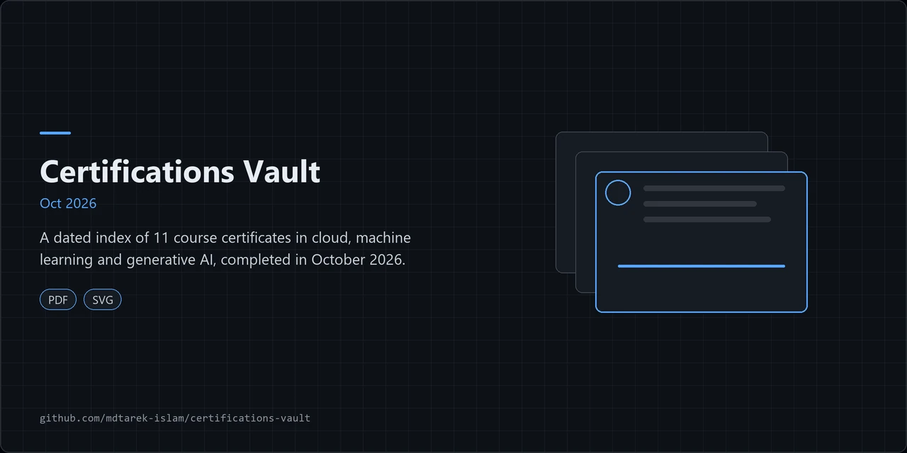

# Certifications Vault

A personal vault of PDF certificates and completion badges, indexed by issuer, domain and date.

## Overview

This repository stores the PDF certificates and completion badges earned by Md Tarek Islam. It holds 11 documents from 2 issuers, completed between 15 and 17 October 2026. It contains no software.

| Issuer | Documents | Completed |
|---|---|---|
| AWS Training and Certification | 6 | 17 Oct 2026 |
| Claude Academy | 5 | 15 to 16 Oct 2026 |

## Architecture

The diagram sorts the vault in three steps.

1. Issuer: each PDF belongs to one issuer, AWS Training and Certification or Claude Academy.
2. Domain: each certificate maps to one of four domains: Cloud, Machine learning, Generative AI or AI tooling.
3. Timeline: each certificate sits under its completion date, 15, 16 or 17 October 2026.

Node numbers in the diagram match the `#` column in the index below.

The second diagram shows the four steps to add a certificate to the vault.

## Features

### Certificate index

| # | Title | Issuer | Domain | Completed | Document | Verify |
|---|---|---|---|---|---|---|
| 1 | AWS Billing and Cost Management | AWS | Cloud | 17 Oct 2026 | [PDF](./AWS%20-%20Billing%20and%20Cost%20Management.pdf) | See PDF |
| 2 | Fundamentals of Machine Learning and Artificial Intelligence | AWS | Machine learning | 17 Oct 2026 | [PDF](./AWS%20-%20Fundamentals%20of%20Machine%20Learning.pdf) | See PDF |
| 3 | Fundamentals of Prompt Engineering with Claude | AWS | Generative AI | 17 Oct 2026 | [PDF](./AWS%20-%20Fundamentals%20of%20Prompt%20Engineering%20with%20Claude.pdf) | See PDF |
| 4 | Introduction to Claude Platform on AWS | AWS | AI tooling | 17 Oct 2026 | [PDF](./AWS%20-%20Introduction%20to%20Claude%20Platform%20on%20AWS.pdf) | See PDF |
| 5 | Introduction to Generative AI: Art of the Possible | AWS | Generative AI | 17 Oct 2026 | [PDF](./AWS%20-%20Introduction%20to%20Generative%20AI%20-%20Art%20of%20the%20Possible.pdf) | See PDF |
| 6 | Job Roles in the Cloud | AWS | Cloud | 17 Oct 2026 | [PDF](./AWS%20-%20Job%20Roles%20in%20the%20Cloud.pdf) | See PDF |
| 7 | Claude 101 | Claude Academy | AI tooling | 15 Oct 2026 | [PDF](./CLAUDE%20ACADEMY%20-%20Claude%20101.pdf) | [Verify](https://academy.claude.com/verify/35734aed9d946c2bcf04142d81f72c80) |
| 8 | Claude Code 101 | Claude Academy | AI tooling | 15 Oct 2026 | [PDF](./CLAUDE%20ACADEMY%20-%20Claude%20Code%20101.pdf) | [Verify](https://academy.claude.com/verify/f3429b2c413ef3b1cbf0316be64b62fa) |
| 9 | Claude Code in Action | Claude Academy | AI tooling | 16 Oct 2026 | [PDF](./CLAUDE%20ACADEMY%20-%20Claude%20Code%20in%20Action.pdf) | [Verify](https://academy.claude.com/verify/9dfc136a80ea983955109f4a35fc79b9) |
| 10 | AI Fluency: Framework and Foundations | Claude Academy | Generative AI | 16 Oct 2026 | [PDF](./CLAUDE%20ACADEMY%20-%20AI%20Fluency%20Framework%20Foundations.pdf) | [Verify](https://academy.claude.com/verify/aa0fddd2f7ab5515d59de5722cd4d8f2) |
| 11 | AI Capabilities and Limitations | Claude Academy | Generative AI | 16 Oct 2026 | [PDF](./CLAUDE%20ACADEMY%20-%20AI%20Capabilities%20and%20Limitations.pdf) | [Verify](https://academy.claude.com/verify/b568951506af1f595bf62a845933b65d) |

### Engineering findings

1. The AWS certificates print 17 October 2026 as the completion date.
2. The Claude Academy dates come from the issue metadata of each PDF.
3. Claude Academy badges carry a public verification link. The AWS PDFs carry no link in this index, so check the document itself.

## Quick start

1. Clone the repository: `git clone https://github.com/mdtarek-islam/certifications-vault.git`
2. Open any PDF from the index with a PDF viewer.
3. For a Claude Academy badge, open its Verify link in a browser.
4. For an AWS certificate, read the details printed on the PDF.

## Configuration

No configuration needed.

## Usage

Add a new certificate in 4 steps.

1. Name the file `ISSUER - Title.pdf`, for example `AWS - Job Roles in the Cloud.pdf`. Use `CLAUDE ACADEMY` for Claude Academy badges.
2. Place the PDF in the repository root.
3. Add a row to the Certificate index, and update the issuer table in the Overview. Encode spaces as `%20` in the Document link.
4. Edit `./assets/architecture.svg`: add a certificate node under its date and domain row, and update the counts on the issuer and domain nodes.

## Licence and contribution

The repository is proprietary. All rights reserved. See [LICENSE](./LICENSE). Certificate designs, logos and issuer marks belong to their issuers, and this repository grants no rights to them.

This vault is personal and accepts no contributions. To report an error in the index, open a GitHub issue.

## Maintenance status

Active. The vault grows as courses complete, and the latest entry is dated 17 October 2026.
