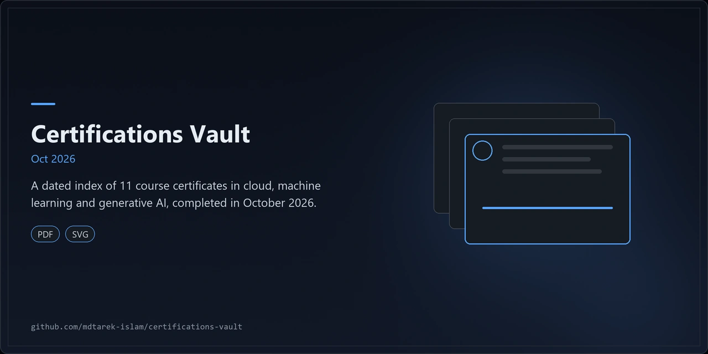
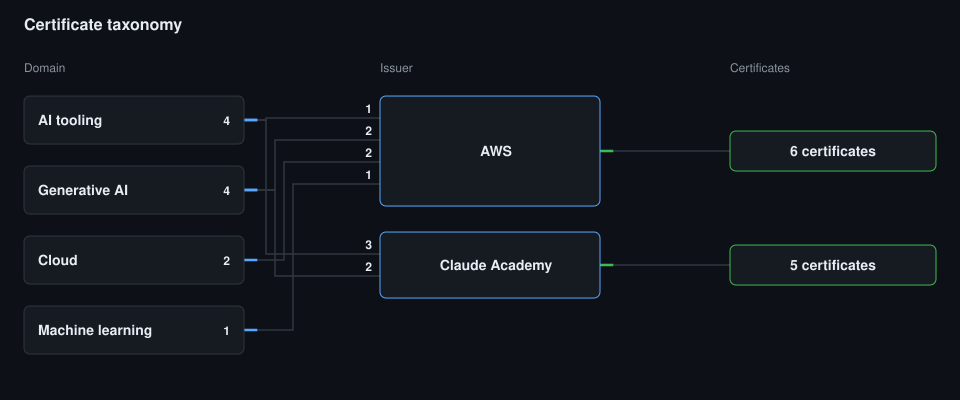
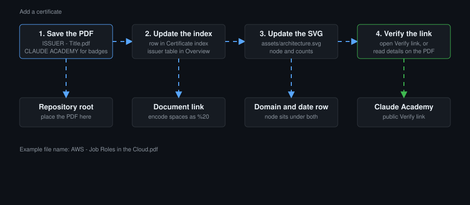

<p align="center"></p>

# Certifications Vault

A personal vault of PDF certificates and completion badges, indexed by issuer, domain and date.

## Overview

This repository stores the PDF certificates and completion badges earned by Md Tarek Islam. It contains no software.

<!-- CERTS-COUNT:START -->
It holds 21 documents from 3 issuers, completed between 15 October 2026 and 13 November 2026.

| Issuer | Documents | Completed |
|---|---|---|
| AWS | 6 | 17 Oct 2026 |
| Claude Academy | 5 | 15 to 16 Oct 2026 |
| Coursera | 10 | 12 to 13 Nov 2026 |
<!-- CERTS-COUNT:END -->

## Architecture



The diagram maps the vault in three columns. A script regenerates it from the files.

1. Domain: each certificate maps to one domain, such as Cloud or Machine learning.
2. Issuer: lines join each domain to the issuers that hold certificates in it. Numbers on the lines count certificates.
3. Count: each issuer shows its total number of certificates.



The second diagram shows the steps to add a certificate to the vault.

## Features

### Certificate index

<!-- CERTS:START -->
| # | Title | Issuer | Domain | Completed | Document | Verify |
|---|---|---|---|---|---|---|
| 1 | AWS Billing and Cost Management | AWS | Cloud | 17 Oct 2026 | [PDF](./AWS%20-%20Billing%20and%20Cost%20Management.pdf) | See document |
| 2 | Fundamentals of Machine Learning and Artificial Intelligence | AWS | Machine learning | 17 Oct 2026 | [PDF](./AWS%20-%20Fundamentals%20of%20Machine%20Learning.pdf) | See document |
| 3 | Fundamentals of Prompt Engineering with Claude | AWS | Generative AI | 17 Oct 2026 | [PDF](./AWS%20-%20Fundamentals%20of%20Prompt%20Engineering%20with%20Claude.pdf) | See document |
| 4 | Introduction to Claude Platform on AWS | AWS | AI tooling | 17 Oct 2026 | [PDF](./AWS%20-%20Introduction%20to%20Claude%20Platform%20on%20AWS.pdf) | See document |
| 5 | Introduction to Generative AI: Art of the Possible | AWS | Generative AI | 17 Oct 2026 | [PDF](./AWS%20-%20Introduction%20to%20Generative%20AI%20-%20Art%20of%20the%20Possible.pdf) | See document |
| 6 | Job Roles in the Cloud | AWS | Cloud | 17 Oct 2026 | [PDF](./AWS%20-%20Job%20Roles%20in%20the%20Cloud.pdf) | See document |
| 7 | Claude 101 | Claude Academy | AI tooling | 15 Oct 2026 | [PDF](./CLAUDE%20ACADEMY%20-%20Claude%20101.pdf) | [Verify](https://academy.claude.com/verify/35734aed9d946c2bcf04142d81f72c80) |
| 8 | Claude Code 101 | Claude Academy | AI tooling | 15 Oct 2026 | [PDF](./CLAUDE%20ACADEMY%20-%20Claude%20Code%20101.pdf) | [Verify](https://academy.claude.com/verify/f3429b2c413ef3b1cbf0316be64b62fa) |
| 9 | AI capabilities and limitations | Claude Academy | Generative AI | 16 Oct 2026 | [PDF](./CLAUDE%20ACADEMY%20-%20AI%20Capabilities%20and%20Limitations.pdf) | [Verify](https://academy.claude.com/verify/b568951506af1f595bf62a845933b65d) |
| 10 | AI Fluency: Framework and foundations | Claude Academy | Generative AI | 16 Oct 2026 | [PDF](./CLAUDE%20ACADEMY%20-%20AI%20Fluency%20Framework%20Foundations.pdf) | [Verify](https://academy.claude.com/verify/aa0fddd2f7ab5515d59de5722cd4d8f2) |
| 11 | Claude Code in action | Claude Academy | AI tooling | 16 Oct 2026 | [PDF](./CLAUDE%20ACADEMY%20-%20Claude%20Code%20in%20Action.pdf) | [Verify](https://academy.claude.com/verify/9dfc136a80ea983955109f4a35fc79b9) |
| 12 | Google AI for App Building | Coursera | Artificial intelligence | 12 Nov 2026 | [PDF](./COURSERA%20-%20GOOGLE%20AI%20for%20App%20Building.pdf) | [Verify](https://coursera.org/verify/L0RQ80WFZE68) |
| 13 | Google AI for Brainstorming and Planning | Coursera | Artificial intelligence | 12 Nov 2026 | [PDF](./COURSERA%20-%20GOOGLE%20AI%20for%20Brainstorming%20and%20Planning.pdf) | [Verify](https://coursera.org/verify/BWL9FQN89VS3) |
| 14 | Google AI for Content Creation | Coursera | Artificial intelligence | 12 Nov 2026 | [PDF](./COURSERA%20-%20GOOGLE%20AI%20for%20Content%20Creation.pdf) | [Verify](https://coursera.org/verify/FVYW2OAM2DGL) |
| 15 | Google AI for Data Analysis | Coursera | Artificial intelligence | 12 Nov 2026 | [PDF](./COURSERA%20-%20GOOGLE%20AI%20for%20Data%20Analysis.pdf) | [Verify](https://coursera.org/verify/4ULG1YZSR1SE) |
| 16 | Google AI for Research and Insights | Coursera | Artificial intelligence | 12 Nov 2026 | [PDF](./COURSERA%20-%20GOOGLE%20AI%20for%20Research%20and%20Insights.pdf) | [Verify](https://coursera.org/verify/O3WNXP62Y81A) |
| 17 | Google AI for Writing and Communicating | Coursera | Artificial intelligence | 12 Nov 2026 | [PDF](./COURSERA%20-%20GOOGLE%20AI%20for%20Writing%20and%20Communicating.pdf) | [Verify](https://coursera.org/verify/G8IHQ9WHQ94V) |
| 18 | Google AI Fundamentals | Coursera | Artificial intelligence | 12 Nov 2026 | [PDF](./COURSERA%20-%20GOOGLE%20AI%20Fundamentals.pdf) | [Verify](https://coursera.org/verify/3BRU6TFH81Y8) |
| 19 | UNESCO Global MOOC on the Ethics of AI | Coursera | AI governance | 12 Nov 2026 | [PDF](./COURSERA%20-%20UNESCO%20Global%20MOOC%20on%20the%20Ethics%20of%20AI.pdf) | [Verify](https://coursera.org/verify/PZO97NIP2AY0) |
| 20 | Google AI for App Deployment | Coursera | Artificial intelligence | 13 Nov 2026 | [PDF](./COURSERA%20-%20GOOGLE%20AI%20for%20App%20Deployment.pdf) | [Verify](https://coursera.org/verify/4MNO8Y6JBPUC) |
| 21 | Google AI Professional Certificate | Coursera | Artificial intelligence | 13 Nov 2026 | [PDF](./COURSERA%20-%20GOOGLE%20AI%20Professional%20Certificate.pdf) | [Verify](https://coursera.org/verify/professional-cert/KYDGIRH2F93K) |
<!-- CERTS:END -->

### Engineering findings

1. The AWS certificates print 17 October 2026 as the completion date.
2. The Claude Academy dates come from the issue metadata of each PDF.
3. Claude Academy badges carry a public verification link. The AWS PDFs carry no link in this index, so check the document itself.
4. Coursera certificates carry a coursera.org verification link. The file name prefix sets the issuer.

## Quick start

1. Clone the repository: `git clone https://github.com/mdtarek-islam/certifications-vault.git`
2. Open any PDF from the index with a PDF viewer.
3. For a Claude Academy badge or a Coursera certificate, open its Verify link in a browser.
4. For an AWS certificate, read the details printed on the PDF.

## Configuration

No configuration needed.

## Usage

Add a new certificate in 3 steps.

1. Name the file `ISSUER - Title.pdf`, for example `AWS - Job Roles in the Cloud.pdf`. Use `CLAUDE ACADEMY` for Claude Academy badges.
2. Place the file in the repository root, or in a folder named after the issuer.
3. Run `python scripts/sync_local.py`. It rewrites the index, the diagram and the README tables, then commits and pushes to `main`.

`sync_local.py` detects added, modified and renamed certificates. It builds the commit message from that diff and asks for confirmation before it commits.
Pass `--dry-run` to print the plan, `--no-push` to commit only, and `--include-deletions` to commit removed files.

To regenerate the outputs without git, run `python scripts/sync_certificates.py`.
The `--check` flag exits with 1 when outputs are stale. The `--dry-run` flag lists changes and writes nothing.
To fix a field, add an entry keyed by the file SHA-256 to `docs/certificates-overrides.json`. The script never rewrites that file.

The `sync-certifications` workflow runs the parser daily at 08:40 UTC and on manual dispatch. It commits only when the output changes.

### Daily local push

A Windows scheduled task runs `scripts/run_daily_sync.cmd` at 08:15 local time each day. The task runs only while you are logged on, so Git Credential Manager can sign in.

1. The task runs `sync_local.py --yes` with no prompt.
2. The script stops with a non-zero exit code if the branch is not `main`, a rebase is in progress, or a git step fails.
3. A failed rebase onto `origin/main` is aborted, so the work tree stays clean.
4. The script stages exact paths only and never commits removed files.
5. With nothing to sync, the script exits with code 0.

Register the task with the path to your Python interpreter:

```powershell
powershell -NoProfile -ExecutionPolicy Bypass -File scripts\register_daily_task.ps1 -PythonPath "C:\path\to\python.exe"
```

Remove it with the `-Unregister` switch. Re-registering replaces the task.
The wrapper appends each run to `%LOCALAPPDATA%\certifications-vault\sync.log`.
If the PC is off at 08:15, the task runs at the next start.

## Licence and contribution

The repository is proprietary. All rights reserved. See [LICENSE](./LICENSE). Certificate designs, logos and issuer marks belong to their issuers, and this repository grants no rights to them.

This vault is personal and accepts no contributions. To report an error in the index, open a GitHub issue.

## Maintenance status

<!-- CERTS-STATUS:START -->
Active. The vault grows as courses complete, and the latest entry is dated 13 November 2026.
<!-- CERTS-STATUS:END -->
